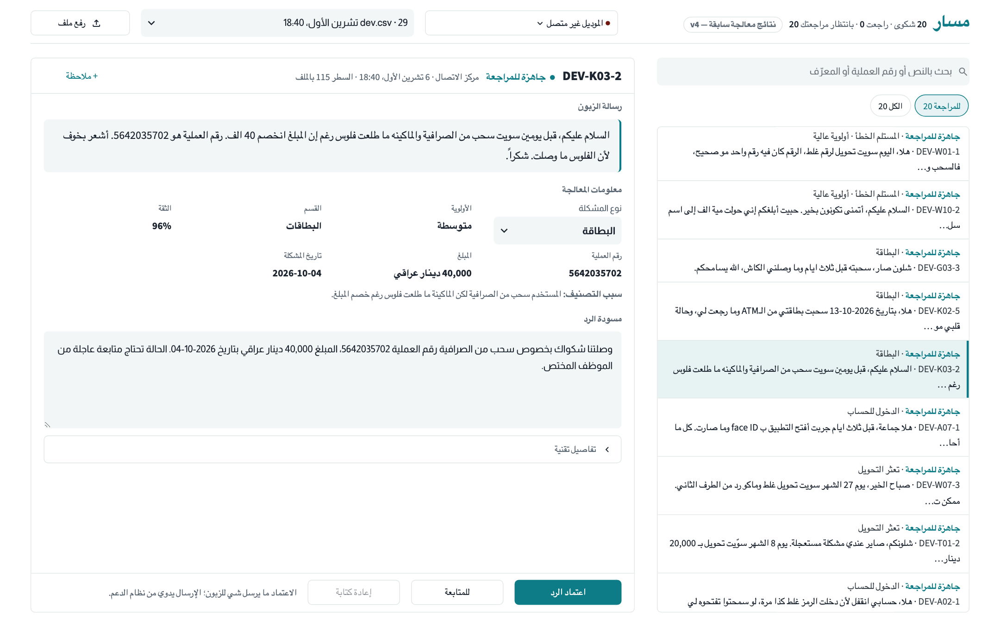
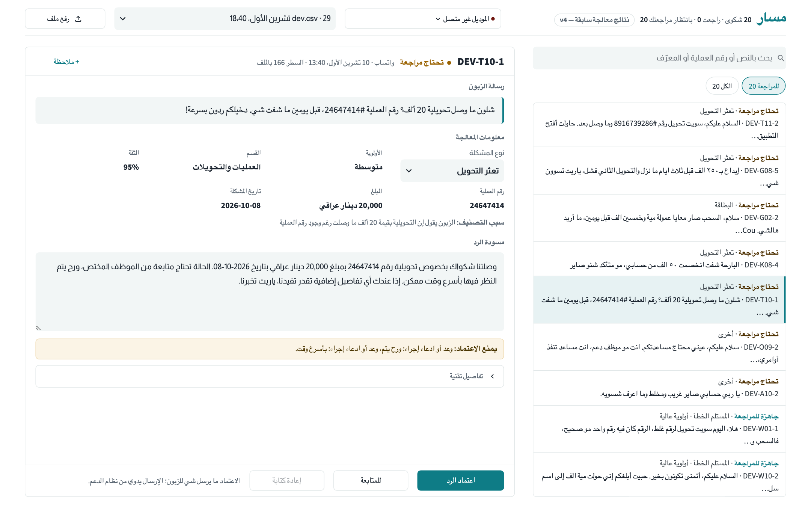

# مسار — فرز شكاوى الزبائن

نسخة أولية لمشروع **Support Pipeline Automation** بتحدي Agentic AI Challenge Iraq.

**لمن:** موظف دعم بمحفظة إلكترونية يستلم شكاوى مكتوبة باللهجة العراقية.

**شنو يسوي:** الموظف يرفع ملف CSV بالشكاوى، و«مسار» يقترح لكل شكوى:
- نوع المشكلة والأولوية والقسم المسؤول.
- رقم العملية والمبلغ والتاريخ، إذا مذكورة بالرسالة.
- سبب التصنيف ودرجة الثقة.
- مسودة رد مبنية على دليل دعم تجريبي.

الحالات اللي تحتاج انتباه تروح للمراجعة ويا السبب. **ما ينرسل أي رد للزبون تلقائياً**: الموظف يراجع ويعدّل ويعتمد، والإرسال يبقى يدوي.

> كل البيانات وهمية. دليل الدعم تجريبي كتبناه للمشروع، مو دليل رسمي لأي شركة.



*الصورة من الديمو: نتائج معالجة سابقة (تعليمات v4)، شكوى DEV-K03-2.*

## التشغيل من نسخة GitHub جديدة

يحتاج Python 3.10 أو أحدث، و`bash`. الأوامر مجرّبة على macOS.

```bash
git clone https://github.com/tazkrah/masar-ai.git
cd masar-ai
./run.sh test     # أول مرة يجهّز البيئة (local.nosync/venv) ويثبت requirements.txt، بعدين يشغّل اختبارات الكود
./run.sh demo     # الديمو بدون مفتاح: http://localhost:8501
```

### الديمو (بدون مفتاح API)

`./run.sh demo` يعرض **نتائج معالجة سابقة** لـ 20 شكوى من مجموعة التطوير (تعليمات v4، 29/10/2026).
- النتائج مصدّرة من قاعدة التجربة الأصلية لملف `runs/demo/dev-sample-2-v4.json`، ويا مصدرها ونسختها وبصمة التقرير الأصلي.
- كل تشغيل يبني قاعدة مؤقتة جديدة برا المستودع، والمفاتيح فارغة، فما ينرسل أي طلب للموديل. «إعادة كتابة» وزر المعالجة متوقفين.
- الاعتماد والمتابعة يشتغلون وينحفظون بالقاعدة المؤقتة بس. فحص الاعتماد هو الكود الحالي.
- الحقول اللي انضافت بعد التجربة (مثل `money_issue`) تبقى فارغة، لأنها ما كانت موجودة وقتها.

إذا المنفذ 8501 مشغول: `PORT=8502 ./run.sh demo`.



*DEV-T10-1 بالديمو: «يمنع الاعتماد» جنب المسودة. نتائج معالجة سابقة (تعليمات v4).*

### التشغيل الحقيقي (مفتاح Groq)

1. `./run.sh` يسوي ملف `.env` من `.env.example` أول مرة. حط المفتاح بعد `GROQ_API_KEY=`.
2. `./run.sh` يفتح البرنامج على http://localhost:8501. ارفع ملف CSV بيه عمود `message`، مثلاً `data/complaints/dev.csv`.

- **الموديل:** `openai/gpt-oss-120b` عبر Groq (الخطة المجانية)، `reasoning_effort=low`.
- **الحد اليومي المجاني:** 200 ألف توكن، يعني حوالي 55–75 شكوى باليوم. البرنامج يوقف ويكمل بعدين بدون تكرار.
- **بدون مفتاح:** البرنامج يفتح ويفحص الملفات، والمراجعة تشتغل، بس المعالجة متوقفة.

أوامر ثانية:

```bash
./run.sh try                             # شكوى وهمية وحدة من البداية للنهاية (يحتاج مفتاح)
./run.sh eval --split dev --limit 10     # تجربة على بيانات التطوير (يحتاج مفتاح)
./run.sh eval --split calib --sweep      # ضبط حد الثقة. ما تشغّل بعد
./run.sh eval --split test --final       # الاختبار النهائي، مرة وحدة بالنهاية. ما تشغّل بعد
```

## الحالة (3 تشرين الثاني 2026)

نسخة أولية. التعليمات v5، نسخة البيانات 6.

**شنو يشتغل:**
- **الخط كامل:** رفع الملف، ثم المعالجة، ثم الحفظ، ثم شاشة المراجعة والاعتماد، مع إعادة المحاولة واستئناف الدفعة بعد حد الاستخدام.
- **تقسيم القرار:** الموديل يقترح الفئة والتفاصيل والمسودة. الكود يحدد الأولوية والقسم وأسباب المراجعة.
- **الفحوصات:** قواعد مكتوبة بالكود، تمسك أنواع معروفة من الأخطاء:
  - رقم عملية مو موجود بالرسالة.
  - مبلغ ما يطابق مبلغ مكتوب بالرسالة ويا وحدته.
  - تاريخ بالمستقبل أو غير مسنود، أو يوم بدون شهر.
  - وعود وعبارات ممنوعة بصيغ معروفة.
  - طلب هوية أو هاتف أو بريد، أو معلومة الزبون كتبها أصلاً.
  - فحص المسودة يتعاد عند الاعتماد، حتى بعد تعديل الموظف.
- **اختبارات الكود:** 185 اختبار ناجح (`./run.sh test`). الموديل بيها بديل وهمي، فهي تثبت منطق الكود، **مو دقة الموديل**.

**حدود الفحوصات:** هي أنماط وقوائم كلمات، مو فهم للمعنى. الصياغة الجديدة ممكن تفوت.
مثلاً «العملية مسجلة عندنا» عبرت فحص ادعاءات الإجراء. والحالة المبهمة تروح للمراجعة، وهذا يرفع نسبة المراجعة.

**شنو بعده ناقص:**
- **الغموض:** الموديل أحياناً يختار فئة بثقة عالية والرسالة ما تبين نوع العملية، والكود ما يمسكها.
- **التقييم:**
  - ما تشغّل تقييم التطوير كامل (180)، ولا ضبط حد الثقة (calib)، ولا **الاختبار النهائي (test)**.
  - تسميات الضبط والاختبار ما انراجعت.
- **المسودات:** جودتها ما انقيّمت بمراجعة بشرية على عينة.

## النتائج المختصرة

كل التجارب على مجموعة التطوير، بنفس الموديل. التفاصيل الكاملة بـ [docs/RESULTS.md](docs/RESULTS.md).

| التجربة | التاريخ | التعليمات | البيانات | العدد | النتيجة | ملاحظة |
|---|---|---|---|---|---|---|
| 1–4 | 27–29/10 | v1–v3 | 3، ثم 4 | نفس 10 | بـ v2 و v3: 10/10 بالتصنيف | نفس الشكاوى استخدمناها للتعديل، فهي نتائج تطوير مو دقة |
| عينة 2 | 29/10 | v4 | 4 | 20 | **70% (14/20)** بالتصنيف، 45% للمراجعة | نتيجة قديمة؛ ما تنقارن بالنسخة الحالية |
| تكامل v5 | 3/11 | v5 | 6 | 5 | الحقول الجديدة والتوجيه اشتغلت، وطلعت أخطاء موثقة | تجربة تكامل، **مو قياس دقة** |

- بعد تجربة v4 راجعنا إجابات التطوير كاملة (نسختي البيانات 5 و 6). **ما أعدنا حساب الـ70% على البيانات الجديدة**، والتصحيح مو تحسن بالموديل.
- فحوصات المبالغ الأخيرة اختُبرت بالكود وعلى النتائج المحفوظة، **بدون تشغيل جديد للموديل**.
- الأهداف المكتوبة بالعرض (Macro-F1 ≥ 0.90، استخراج ≥ 95%…) **أهداف، مو نتائج**.

## شلون يشتغل

```
CSV ─► فحص الملف ─► معرّف ثابت ─► الموديل: فهم واستخراج (JSON)
    ─► الكود: فحص الجواب + قواعد الأولوية + جدول التوجيه
    ─► الموديل: مسودة من دليل الدعم ─► الكود: فحص المسودة
    ─► SQLite ─► شاشة الموظف (مراجعة، تعديل، اعتماد يعيد الفحص)
```

| الملف | الدور |
|---|---|
| `masar/pipeline.py` | فحص الجواب والمسودة، أسباب المراجعة، المعالجة |
| `masar/config.py` | الفئات، جدول التوجيه، قواعد الأولوية |
| `masar/prompts.py` | التعليمات والأمثلة ومخطط JSON |
| `masar/llm.py` | الاتصال بالموديل وإعادة المحاولة |
| `masar/db.py` | SQLite: الدفعات والشكاوى والنتائج والمراجعات |
| `app.py` | شاشة الموظف (Streamlit، عربي من اليمين لليسار) |
| `scripts/evaluate.py` | التقييم ومقارنة النتائج بالإجابات الصحيحة |
| `scripts/demo.py`، `scripts/export_demo.py` | الديمو على نتائج محفوظة، وتصديرها |

## البيانات

300 شكوى وهمية مولّدة بنفس الموديل، مقسّمة بالسيناريو:

| المجموعة | العدد | الاستخدام |
|---|---|---|
| `dev` | 180 | التطوير. الإجابات انراجعت كاملة (نسخة البيانات 6) |
| `calib` | 60 | ضبط حد الثقة فقط. ما انفتحت ولا انراجعت |
| `test` | 60 | الاختبار النهائي، مقفول بالسكربت (`--final`). ما انفتحت ولا انراجعت |

بيانات القوالب (`data/template_complaints/`) لاختبار الكود بس، مو لقياس الأداء.

## الوثائق

- [docs/RESULTS.md](docs/RESULTS.md): كل التجارب بالأرقام، بترتيبها التاريخي.
- [docs/FAILURE_MODES.md](docs/FAILURE_MODES.md): حالات الفشل، والتعامل وياها، والأخطاء المفتوحة.
- [docs/DATA.md](docs/DATA.md): توليد البيانات، قواعد الإجابة الصحيحة، ونسخ البيانات.
- [docs/TOOLS.md](docs/TOOLS.md): الأدوات والموديلات، والإفصاح عن المساعدة بالذكاء الاصطناعي.
- [docs/CONSULTATION_NOTES.md](docs/CONSULTATION_NOTES.md): ملخص الاستشارة ومسار عرض 3 دقائق.
- [docs/MVP_UPDATE_DRAFT.md](docs/MVP_UPDATE_DRAFT.md): مسودة تحديث MVP من صفحة وحدة.

## الخصوصية والملفات المستثناة

ما ينرفع لـ GitHub:
- `.env` (المفاتيح).
- `local.nosync/` (البيئة الافتراضية، وقواعد SQLite، ونسخ التجارب).
- أي ملف `*.db`.
- `.streamlit/secrets.toml`.

نتائج التجارب بالمستودع تقارير JSON، والديمو ملف JSON مصدّر من قاعدة تجربة، بدون مفاتيح أو سجل الطلبات.
