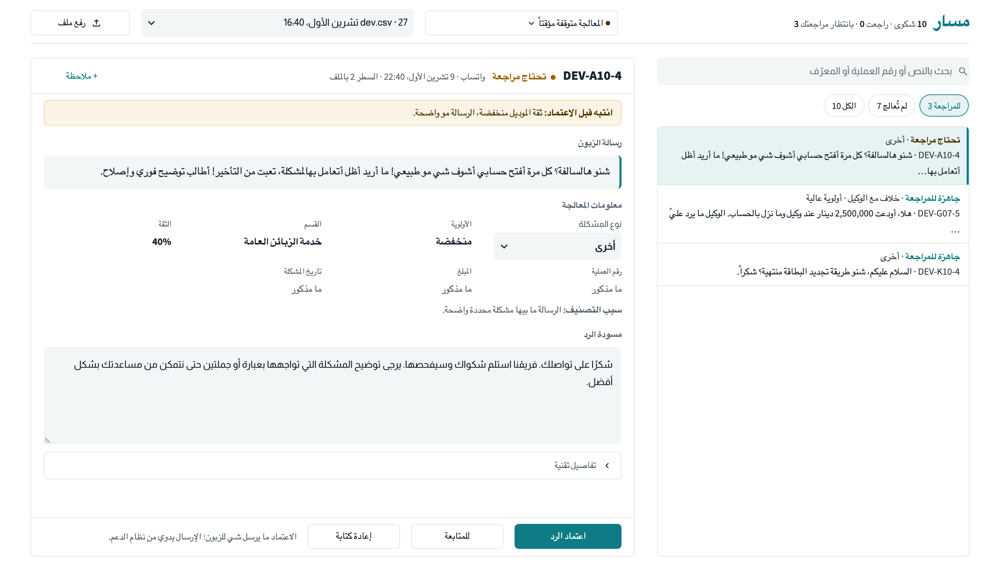
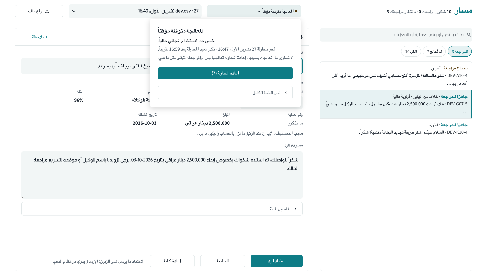

# مسار — تنظيم شكاوى الزبائن

نسخة أولية لمشروع **Support Pipeline Automation** بتحدي Agentic AI Challenge Iraq.

الموظف يرفع ملف CSV بيه شكاوى زبائن باللهجة العراقية، و«مسار» يطلعله لكل شكوى:
نوع المشكلة، الأولوية، القسم المسؤول، رقم العملية والمبلغ والتاريخ إذا مذكورة، درجة الثقة وسبب التصنيف،
ومسودة رد مبنية على دليل دعم تجريبي. الحالات غير الواضحة تروح للمراجعة مع السبب.
**ما ينرسل أي رد للزبون تلقائياً.** الموظف يراجع ويعدّل ويعتمد، والإرسال يبقى يدوي.

> بيانات وهمية فقط. دليل الدعم تجريبي كتبناه للمشروع، مو دليل رسمي لزين كاش.



## حالة المشروع: نسخة أولية (27 تشرين الأول 2026)

### المنجز

| الجزء | الحالة |
|---|---|
| رفع الملف، المعالجة، الحفظ، شاشة المراجعة والاعتماد، إعادة المحاولة | مبني |
| بيانات المسابقة المولّدة بالموديل | **300 شكوى** (Groq، `openai/gpt-oss-120b`)، مقسّمة 180 تطوير / 60 ضبط / 60 اختبار، مع مراجعة يدوية جزئية للتطوير |

### نتائج اختبارات الكود (بدون موديل)

`./run.sh test`: **34/34 ناجحة**. هاي الاختبارات تستبدل الموديل ببديل وهمي، فتثبت منطق الكود
(الفحص، القواعد، الحفظ، إعادة المحاولة، عدم التكرار) ولا تقيس دقة الموديل.

### نتائج الموديل الحقيقي

- **الاتصال الحقيقي نجح:** بتجربة 27/10 على 10 شكاوى تطوير، الموديل عالج 3 شكاوى من البداية للنهاية
  (فهم واستخراج ثم مسودة) بمتوسط حوالي 2.3 ثانية للشكوى.
- **تقييم الدقة ما اكتمل:** الـ7 الباقية، وتجربة ثانية بعدها (10 شكاوى)، فشلت لأن الحد اليومي المجاني للتوكنات (200 ألف) خلص
  بعد توليد البيانات. 3 شكاوى عدد صغير جداً، فما نعلن أي نسبة دقة. التفاصيل بـ [docs/RESULTS.md](docs/RESULTS.md).
- ضبط حد الثقة (calib) والاختبار النهائي (test) ما تشغّلوا.

### أهداف، مو نتائج

الأرقام المكتوبة بالعرض (Macro-F1 ≥ 0.90، استخراج ≥ 95%…) **أهداف**. ما وصلنا بعد لأي رقم يقارن وياها.

## التشغيل

```bash
cd ~/Projects/masar-ai
./run.sh            # أول مرة يجهّز البيئة، بعدين يفتح البرنامج على http://localhost:8501
```

يحتاج Python 3.10 أو أحدث. أول تشغيل يسوي بيئة افتراضية بمجلد `local.nosync/` ويثبت `requirements.txt`.

**الموديل:** `openai/gpt-oss-120b` عبر Groq (الخطة المجانية)، `reasoning_effort=low`.
**المفتاح:** افتح ملف `.env` بمجلد المشروع (ينعمل تلقائياً من `.env.example`) والصق مفتاح Groq بعد `=`:

```
GROQ_API_KEY=...
```

ملف `.env` موجود بـ `.gitignore` وما ينرفع لـ GitHub. بدون مفتاح، البرنامج يفتح ويفحص الملفات، والمراجعة والاعتماد يشتغلون، بس المعالجة متوقفة.
قاعدة البيانات (`local.nosync/masar.db`) محلية وما تنرفع. إعدادات ثانية (حد الثقة، عدد الشكاوى سوية، مزوّد بديل) موضّحة بـ `.env.example`.

أوامر ثانية:

```bash
./run.sh test                            # اختبارات منطق الكود (بدون اتصال بالموديل)
./run.sh try                             # تجربة شكوى وهمية وحدة من البداية للنهاية
./run.sh generate --dry-run              # يعرض تعليمات التوليد بدون اتصال
./run.sh generate                        # يولّد الـ300 شكوى بالموديل (مرة وحدة)
./run.sh eval --split dev --limit 10     # تجربة صغيرة على بيانات التطوير
./run.sh eval --split dev                # التطوير كامل (180)
./run.sh eval --split calib --sweep      # ضبط حد الثقة (60)
./run.sh eval --split test --final       # الاختبار النهائي — مرة وحدة بالنهاية فقط
```

## الواجهة

شاشة وحدة بالعربي (من اليمين لليسار):

- **الشريط العلوي:** ملخص الدفعة (عدد الشكاوى، اللي راجعتها، اللي تنتظر مراجعتك)، اختيار الدفعة، وزر «رفع ملف» يفتح نافذة تفحص الملف قبل الحفظ.
- **حالة المعالجة:** زر صغير بالأعلى («المعالجة متوقفة مؤقتاً»، «170 بانتظار المعالجة»…). الضغط عليه يبين السبب وموعد المحاولة التقريبي
  وزر «ابدأ المعالجة» أو «إعادة المحاولة». توقف الخدمة العام (حد الاستخدام، المفتاح، الاتصال) ينفصل عن خطأ يخص شكوى وحدة.
- **القائمة (يمين):** بحث بالنص أو رقم العملية أو المعرّف، وفلاتر بالأعداد الفعلية (للمراجعة، للمتابعة، معتمدة، فيها خطأ، لم تُعالج، الكل)، وصفحات.
  الشكوى اللي بيها تعديل غير محفوظ تنعلّم.
- **التفاصيل (يسار):** رسالة الزبون، معلومات المعالجة (النوع قابل للتصحيح من مكانه، الأولوية، القسم، الثقة، رقم العملية، المبلغ، التاريخ، سبب التصنيف)،
  ومسودة الرد القابلة للتعديل. «+ ملاحظة» يضيف ملاحظة داخلية. أسباب المراجعة تطلع فوق إذا الشكوى تحتاج انتباه.
- **أزرار القرار (ثابتة تحت):** «اعتماد الرد»، «للمتابعة»، «إعادة كتابة». الاعتماد يرفض المسودة إذا بيها عبارة ممنوعة بدليل الدعم،
  و**ما يرسل شي للزبون**: الإرسال يدوي من نظام الدعم. الشكوى اللي ما انعالجت إلها زر «إعادة المحاولة» يتعطّل مع السبب إذا الخدمة مانعة المحاولة.
- التعديلات (المسودة، النوع، الملاحظة) تبقى لكل شكوى لو انتقلت لغيرها، وتنحفظ ويا القرار.



الصورتين من نتائج التجربة المحفوظة على بيانات وهمية.

## شلون يشتغل

```
CSV ─► فحص الملف ─► معرّف ثابت ─► الموديل: فهم واستخراج (JSON)
    ─► الكود: فحص الجواب + قواعد الأولوية + جدول التوجيه
    ─► الموديل: مسودة من دليل الدعم ─► الكود: فحص العبارات الممنوعة
    ─► SQLite ─► شاشة الموظف (مراجعة، تعديل، اعتماد)
```

| الملف | الدور |
|---|---|
| `masar/ingest.py` | قراءة CSV، رفض الأسطر الفارغة والمكررة، معرّف ثابت لكل شكوى (رقمها بالملف، أو بصمة النص ووقت الاستلام) |
| `masar/llm.py` | استدعاء الموديل بدالة وحدة، وإعادة المحاولة بفواصل تزيد تدريجياً للأخطاء المؤقتة فقط |
| `masar/prompts.py` | التعليمات والأمثلة، ومخطط JSON للجواب |
| `masar/pipeline.py` | فحص الجواب (رقم العملية لازم يكون بنص الرسالة، التاريخ مو بالمستقبل…)، أسباب المراجعة، المسودة |
| `masar/config.py` | الفئات الست، جدول التوجيه، قواعد الأولوية، المعلومات المطلوبة لكل فئة |
| `masar/db.py` | SQLite: دفعات، شكاوى (سجل واحد لكل معرّف)، نتائج، مراجعات |
| `data/support_guide.md` | دليل الدعم التجريبي والعبارات الممنوعة |
| `app.py` | شاشة الموظف (Streamlit) |
| `scripts/generate_llm_dataset.py` + `scripts/scenarios.py` | توليد بيانات المسابقة بالموديل وتقسيمها |
| `scripts/generate_template_dataset.py` | بيانات القوالب لاختبار الكود |
| `scripts/evaluate.py` | التقييم ومقارنة النتائج بالإجابات الصحيحة |

**الموديل يقرر:** نوع المشكلة، التفاصيل، إشارة الخطر، الثقة، سبب التصنيف، نص المسودة.
**الكود يقرر:** الأولوية، القسم، المعلومات الناقصة، هل الشكوى تحتاج مراجعة، ورفض الأجوبة اللي شكلها غلط.

## البيانات

اكو مجموعتين بيانات، وكل وحدة إلها دور:

| المجلد | المصدر | الاستخدام |
|---|---|---|
| `data/complaints/` | **مولّدة بموديل لغوي** (`./run.sh generate`) — هذه بيانات المسابقة | التطوير وضبط الثقة والاختبار النهائي |
| `data/template_complaints/` | قوالب مكتوبة + تعويض خانات بالكود، **مو مولّدة بموديل** | اختبار منطق الكود فقط |

كل مجموعة 300 شكوى على الفئات الست، 60 سيناريو × 5 رسائل، والإجابة الصحيحة بـ `labels/`.
التقسيم بالسيناريو حتى الشكاوى المتشابهة تبقى بنفس المجموعة:

| المجموعة | العدد | الاستخدام |
|---|---|---|
| `dev` | 180 | التطوير وتحسين التعليمات |
| `calib` | 60 | ضبط حد الثقة فقط |
| `test` | 60 | الاختبار النهائي. مقفول بالسكربت (يحتاج `--final`) وكل تشغيل ينسجل |

التفاصيل بـ [docs/DATA.md](docs/DATA.md). النتائج بـ [docs/RESULTS.md](docs/RESULTS.md).
حالات الفشل بـ [docs/FAILURE_MODES.md](docs/FAILURE_MODES.md). الأدوات والموديلات والمساعدة بالذكاء الاصطناعي بـ [docs/TOOLS.md](docs/TOOLS.md).

## الخصوصية والملفات المستثناة

ما ينرفع لـ GitHub: `.env` (المفاتيح)، `local.nosync/` (البيئة الافتراضية وقواعد SQLite ونسخ التجارب)، أي ملف `*.db`، و`.streamlit/secrets.toml`.
كل الشكاوى بالمستودع وهمية.
